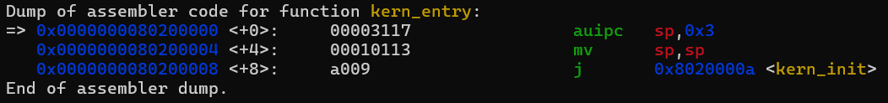
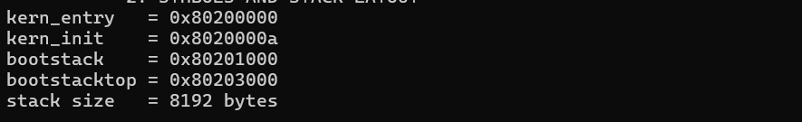
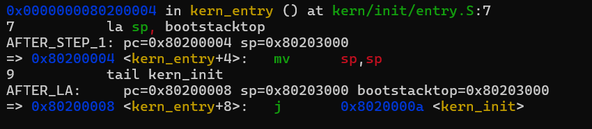
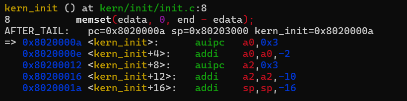

# 操作系统实验报告

## 实验基本信息

| 项目 | 内容 |
|------|------|
| **实验名称** | Lab 1: 最小可执行内核与启动流程 |
| **小组成员** | <2411438>-李熙铭、<2411513>-杨珺童、<2413101>-谢沛霖 |
| **完成日期** | 2026-10-11 |

### 小组分工

练习如何分工？

| 成员 | 负责的练习/模块 |
|------|----------------|
| 李熙铭 | 编译链接与输出链模块、最终报告合并与代码提交 |
| 杨珺童 | 内核入口与栈初始化模块、练习 1 |
| 谢沛霖 | 复位流程与 GDB 调试模块、练习 2 |

实验报告如何分工？

实验报告分为三个分节文档，由三位成员分别撰写对应模块的内容，最后由组长李熙铭合并为总报告，并统一检查格式和截图路径。

---

## 一、实验目的

本实验的主要目的是：

1. 理解 RISC-V 架构下计算机从上电复位到操作系统内核启动的完整流程。
2. 掌握使用链接脚本描述内存布局、进行交叉编译生成内核镜像的方法。
3. 理解 OpenSBI 作为 bootloader 的作用，以及 QEMU 模拟器在操作系统开发中的角色。
4. 掌握使用 GDB 调试操作系统内核的基本方法，能够观察寄存器状态和指令执行过程。

---

## 二、实验环境

### 2.1 AI 工具使用情况

| 成员 | AI 编程工具 | 底层模型 | 备注 |
|------|------------|---------|------|
| 李熙铭 | Cline (VS Code 插件) | Claude Sonnet 4.5 | 用于分析 Makefile 和链接脚本 |
| 杨珺童 | Cline (VS Code 插件) | Claude Sonnet 4.5 | 用于理解入口汇编代码 |
| 谢沛霖 | DeepSeek Harness | DeepSeek-V4-Flash | 用于整理 GDB 调试记录 |

**说明：**

- **AI 编程工具**：指具体使用的终端工具、编辑器插件、桌面应用或浏览器界面。
- **底层模型**：指该工具使用的大语言模型及版本。

---

## 三、实验整体逻辑分析

### 3.1 本章节的逻辑主线

本章实验围绕“**最小可执行内核的启动流程**”这一核心主题展开。

整个实验解决的问题是：

> **如何让一个操作系统内核在 QEMU 模拟的 64 位 RISC-V 计算机上正确启动，并输出第一条调试信息。**

Lab 1 的逻辑主线如下：

```text
CPU 加电复位
  ↓
PC = 0x1000（QEMU 复位地址）
  ↓
执行复位代码，准备 Hart ID / 设备树地址
  ↓
跳转到 OpenSBI（0x80000000 附近）
  ↓
OpenSBI 完成 M 模式初始化
  ↓
OpenSBI 切换到 S 模式，跳转到 0x80200000
  ↓
内核入口 kern_entry
  ↓
设置栈指针 sp = bootstacktop
  ↓
tail kern_init
  ↓
kern_init 清零 .bss、输出启动信息、进入死循环
```

### 3.2 功能的逐步实现

本章实验按照以下顺序逐步实现各个功能：

1. **实现编译、链接与镜像生成**  
   这是后续所有工作的基础。只有正确生成内核镜像，QEMU 才能加载并运行。

2. **实现内核入口与栈初始化**  
   内核第一条指令需要设置好栈指针，才能安全地调用 C 语言函数。

3. **完成 C 语言内核入口 `kern_init`**  
   在 C 语言环境中完成 `.bss` 段清零、输出启动信息等初始化工作。

4. **通过 GDB 调试验证整个启动流程**  
   从复位地址 `0x1000` 到内核入口 `0x80200000`，逐步验证控制权转移过程，形成完整闭环。

---

## 四、实验内容与实现

### 4.1 功能模块：编译、链接与内核输出链

**负责人：** `<2411438>-李熙铭`

#### 4.1.1 模块功能描述

本模块主要实现和分析 Makefile 构建规则与链接脚本，完成源代码到可执行内核镜像的生成，并分析内核启动后的格式化输出调用链。

需要实现/分析的函数包括：

```c
// 本模块主要涉及 Makefile 构建规则与链接脚本，不涉及 C 函数修改
// 核心分析目标：
void cprintf(const char *fmt, ...);
int vcprintf(const char *fmt, va_list ap);
void cons_putc(int c);
void sbi_console_putchar(int ch);
```

#### 4.1.2 编译、链接与镜像生成

本模块负责将源代码经过交叉编译、链接以及 `objcopy` 处理，最终生成：

```text
bin/kernel
bin/ucore.img
```

整体流程可以表示为：

```text
C / 汇编源文件
      ↓
RISC-V 交叉编译器
      ↓
目标文件 .o
      ↓
链接器 + tools/kernel.ld
      ↓
bin/kernel
      ↓
objcopy
      ↓
bin/ucore.img
```

其中：

- `bin/kernel` 是经过链接得到的内核 ELF 文件，包含符号表、段信息等调试所需内容。
- `bin/ucore.img` 是经过 `objcopy` 处理后得到的内核镜像，便于 QEMU 加载执行。
- `tools/kernel.ld` 用于规定内核入口点、代码段和数据段等在内存中的布局。

#### 4.1.3 内核格式化输出调用链

内核输出信息的调用链为：

```text
cprintf
  ↓
vcprintf / vprintfmt
  ↓
cons_putc
  ↓
sbi_console_putchar
  ↓
sbi_call
  ↓
ecall
  ↓
OpenSBI
  ↓
串口输出
```

其核心过程是：

1. `cprintf()` 接收格式化字符串和参数。
2. `vcprintf()` / `vprintfmt()` 对格式化字符串进行解析。
3. `cons_putc()` 输出单个字符。
4. `sbi_console_putchar()` 通过 SBI 接口向 OpenSBI 请求字符输出。
5. `sbi_call()` 对 SBI 调用参数进行封装。
6. 执行 RISC-V 的 `ecall` 指令，使当前 S 模式代码陷入 M 模式的 OpenSBI。
7. OpenSBI 完成底层串口输出。
8. 最终在 QEMU 的终端中看到内核启动信息。

因此，实验中看到的：

```text
(THU.CST) os is loading ...
```

并不是 C 语言函数直接操作终端输出，而是经过 SBI 和 OpenSBI 完成的底层输出。

---

### 4.2 最终提示词

以下是经过迭代优化后，最终成功实现该功能的提示词：

> 请帮我分析 lab1 的 Makefile 和 tools/kernel.ld，说明：
>
> 1. 源文件如何经过编译、链接和 objcopy 生成 `bin/kernel` 与 `bin/ucore.img`；
> 2. 链接脚本中入口点、内核基址和各段内存布局；
> 3. QEMU 如何加载内核镜像，以及 OpenSBI 如何将控制权交给内核；
> 4. 内核格式化输出调用链 `cprintf → ... → ecall → OpenSBI` 的完整过程。

---

### 4.3 实现迭代过程

本模块的实现经历了 2 次迭代。

#### 4.3.1 第一次迭代

**遇到的问题：**

**问题 1：QEMU 版本兼容性问题**

QEMU 版本过高，Makefile 中的：

```bash
-bios default
```

参数与当前环境存在兼容性问题，导致：

```bash
make qemu
```

执行时报错。

**问题 2：内核基址理解不明确**

链接脚本中的内核基址：

```text
0x80200000
```

最初不清楚为什么选择该地址，以及它与 OpenSBI 之间的关系。

**问题解决策略：**

针对问题 1：

- 检查当前 QEMU 版本。
- 修改 Makefile 中的 `QEMUOPTS`。
- 根据实际环境显式指定 OpenSBI 固件路径，或调整 `-bios` 参数。

针对问题 2：

- 查阅 RISC-V 特权级相关资料。
- 分析 OpenSBI 启动流程。
- 确认 `0x80200000` 是 OpenSBI 将控制权交给 S 模式内核时使用的内核入口地址。

#### 4.3.2 第二次迭代

经过第二次调整后，最终实现：

- ✅ 编译通过
- ✅ `make qemu` 成功运行
- ✅ QEMU 输出：

```text
(THU.CST) os is loading ...
```

- ✅ 功能符合实验预期

**关键改进点总结：**

1. 在 Makefile 中增加 QEMU 版本兼容性处理。
2. 明确链接脚本中 `.text`、`.rodata`、`.data`、`.bss` 的布局关系。
3. 理解 QEMU、OpenSBI 和 uCore 内核之间的控制权转移关系。
4. 梳理从 `cprintf()` 到 `ecall` 再到 OpenSBI 的完整输出路径。

---

## 五、练习 1 —— 内核入口指令解释

**负责人：** `<2411513>-杨珺童`

### 5.1 练习要求

解释 `kern/init/entry.S` 中以下两条入口指令的作用：

```asm
la sp, bootstacktop
tail kern_init
```
### 5.2 源码与内核栈布局

`kern/init/entry.S` 中与本练习有关的代码如下：

```asm
.globl kern_entry
kern_entry:
    la sp, bootstacktop
    tail kern_init

.section .data
    .align PGSHIFT
.global bootstack
bootstack:
    .space KSTACKSIZE
.global bootstacktop
bootstacktop:
```

内核栈的大小由 `kern/mm/mmu.h` 和 `kern/mm/memlayout.h` 共同确定：

```c
#define PGSIZE      4096
#define PGSHIFT     12
#define KSTACKPAGE  2
#define KSTACKSIZE  (KSTACKPAGE * PGSIZE)
```

因此：

```text
KSTACKSIZE = 2 × 4096 = 8192 Byte = 8 KiB
```

`.align PGSHIFT` 将 `bootstack` 按照 `2^12 = 4096` 字节对齐。当前构建产物中的符号地址如下：

| 符号 | 地址 | 含义 |
|---|---:|---|
| `kern_entry` | `0x80200000` | 内核汇编入口 |
| `kern_init` | `0x8020000a` | C语言内核入口 |
| `bootstack` | `0x80201000` | 内核栈低地址边界 |
| `bootstacktop` | `0x80203000` | 内核栈高地址边界和初始栈顶 |

内核栈占用区间为 `[0x80201000, 0x80203000)`，大小正好为 `0x2000`，即8192字节。RISC-V栈按照调用约定从高地址向低地址增长，因此入口代码将`sp`设置为高地址端的`bootstacktop`，后续压栈时再向低地址移动。

### 5.3 `la sp, bootstacktop` 的作用

`la`是RISC-V汇编伪指令，全称为Load Address。它把符号`bootstacktop`的地址加载到栈指针寄存器`sp`，而不是读取该地址中保存的数据。

当前内核的实际反汇编结果为：

```asm
0000000080200000 <kern_entry>:
    80200000: 00003117    auipc sp,0x3
    80200004: 00010113    mv    sp,sp
```

这里的`mv sp,sp`是反汇编器对`addi sp,sp,0`显示的别名。两条机器指令配合完成PC相对地址计算，最终得到：

```text
sp = 0x80200000 + 0x3000 = 0x80203000
   = bootstacktop
```

#### 必须在调用 C 函数前设置 `sp`

C 语言函数运行时需要使用栈保存：

- 局部变量；
- 函数参数；
- 返回地址；
- 保存寄存器；
- 临时数据。

如果 `sp` 没有被初始化，继续使用OpenSBI遗留的栈指针,那么 C 函数执行过程中对栈的访问就可能发生在错误的内存位置，从而导致不可预测的行为甚至程序崩溃。

因此，设置内核栈是从汇编入口进入 C 语言环境的重要准备工作。

---

### 5.4 `tail kern_init` 的作用

`tail`也是一条伪指令，用于进行尾调用。它把PC修改为`kern_init`的地址，但不把返回地址写入`ra`。当前内核中`kern_init`与`kern_entry`距离很近，因此链接器将其生成为一条压缩跳转指令：

```asm
80200008: a009    j 8020000a <kern_init>
```

这条指令只改变PC，不创建新的返回关系。这样处理是合理的，因为`kern_entry`只负责建立C语言运行环境，而`kern_init`被声明为`noreturn`，完成初始化和输出后会进入死循环，不需要返回到`kern_entry`。

普通函数调用与这里的尾调用可以对比如下：

| 调用方式 | 是否保存返回地址 | 是否需要返回调用点 |
|---|---|---|
| `call kern_init` | 是，写入`ra` | 通常需要 |
| `tail kern_init` | 否 | 不需要 |

### 5.5 两条指令的整体关系

```text
OpenSBI将控制权交给0x80200000
                ↓
            kern_entry
                ↓
la sp, bootstacktop：sp = 0x80203000 --初始化内核栈
                ↓
tail kern_init：pc = 0x8020000a --进入 C 语言内核
                ↓
            kern_init
                ↓
清理.bss、输出启动信息并进入死循环
```

两条指令共同完成了从固件提供的S模式执行环境到内核自身C语言运行环境的过渡：第一条指令建立内核栈，第二条指令进入C语言初始化入口。

### 5.6 反汇编和符号验证

在WSL终端中执行：

```bash
riscv64-unknown-elf-objdump -d bin/kernel | sed -n '/<kern_entry>:/,+5p'
riscv64-unknown-elf-nm -n bin/kernel | grep -E 'kern_entry|kern_init|bootstack'
```

第一条命令用于显示`kern_entry`的真实机器指令，第二条命令用于核对入口函数和内核栈符号的地址。图5-1表明，`la`实际展开为`auipc`和`mv`，`tail`实际生成为跳转到`0x8020000a`的`j`指令。



图5-2给出了当前构建产物中的实际符号地址。`bootstacktop - bootstack = 0x2000 = 8192`字节，与`KSTACKSIZE`的宏定义一致。



### 5.7 GDB验证`sp`和`pc`变化

首先执行`bash tools/entry-stack-debug.sh`启动暂停状态的QEMU，在另一个终端执行`make gdb`连接。随后在GDB中执行：

```gdb
break kern_entry
continue
disassemble /r kern_entry
info registers pc sp
p/x &bootstack
p/x &bootstacktop
p/d (char *)&bootstacktop - (char *)&bootstack
```

在执行入口指令前，`pc`应为`0x80200000`；此时`sp`仍是OpenSBI移交控制权时留下的值，尚未指向内核自己的栈。


接着逐条执行：

```gdb
stepi
info registers pc sp
stepi
info registers pc sp
stepi
info registers pc sp
```

关键变化如下：

| 执行阶段 | `pc` | `sp` | 说明 |
|---|---:|---:|---|
| 到达`kern_entry` | `0x80200000` | OpenSBI遗留值 | 尚未建立内核栈 |
| 执行`la`对应的两条机器指令后 | `0x80200008` | `0x80203000` | `sp`等于`bootstacktop` |
| 执行`tail`对应的跳转后 | `0x8020000a` | `0x80203000` | PC进入`kern_init`，栈保持不变 |

图5-4显示，执行`la`展开后的第一条机器指令时，`sp`已经得到`0x80203000`；执行第二条机器指令后，`pc`到达`0x80200008`，且`sp`与`bootstacktop`相等。



图5-5显示，执行`tail kern_init`对应的跳转指令后，`pc`变为`0x8020000a`，与`kern_init`地址一致；`sp`保持为`0x80203000`，说明控制权已经在内核栈保持有效的情况下进入C语言入口。



仓库提供的自动验证日志还记录了：

```text
STACK sp=0x80203000 top=0x80203000 size=8192
```

该结果同时验证了`sp`、`bootstacktop`和`KSTACKSIZE`三者的关系。

### 5.8 练习1结论

`la sp, bootstacktop`把内核栈顶地址加载到`sp`，使内核不再依赖OpenSBI使用的栈，并为执行C函数建立符合RISC-V调用约定的栈环境。`tail kern_init`在不保存返回地址的情况下跳转到C语言入口。由于`kern_init`不会返回，这种尾调用既符合控制流程，也避免了无意义的返回地址保存。GDB验证表明，入口代码执行后`sp`变为`0x80203000`，随后`pc`从`0x80200008`跳转到`kern_init`所在的`0x8020000a`，与源码和反汇编结果一致。

---

## 六、练习 2 —— 从加电复位到内核第一条指令

**负责人：** `<2413101>-谢沛霖`

### 6.1 练习要求

记录从 CPU 加电复位到执行内核第一条指令的完整调试过程。

---

### 6.2 调试方法

打开两个终端。

#### 终端 A

```bash
make debug
```

#### 终端 B

```bash
make gdb
```

其中：

- `make debug` 用于启动 QEMU 调试模式。
- `make gdb` 用于启动 GDB 并连接到 QEMU。

---

### 6.3 CPU 复位地址与初始指令

QEMU 模拟的 RISC-V CPU 复位后：

```text
PC = 0x1000
```

在 GDB 中执行：

```gdb
(gdb) x/8i 0x1000
```

可以查看复位向量位置处的初始指令。

这些指令主要负责：

- 准备 Hart ID；
- 准备设备树地址；
- 完成早期启动环境准备；
- 跳转到 OpenSBI。

截图位置：

```text
./images/gdb/02_gdb_0x1000.png
```

---

### 6.4 从复位到 OpenSBI

CPU 复位后，首先从 `0x1000` 开始执行。

启动过程可以概括为：

```text
CPU Reset
   ↓
PC = 0x1000
   ↓
执行复位向量
   ↓
准备 Hart ID / DTB 地址
   ↓
跳转到 OpenSBI
   ↓
OpenSBI M 模式初始化
```

OpenSBI 运行在 RISC-V 的 **M（Machine）模式**，主要负责：

1. 初始化机器模式运行环境；
2. 配置异常和中断委托；
3. 初始化必要的硬件或平台相关服务；
4. 提供 SBI（Supervisor Binary Interface）服务；
5. 准备进入 S（Supervisor）模式；
6. 将控制权转交给操作系统内核。

---

### 6.5 从 OpenSBI 到 `kern_entry`

OpenSBI 初始化完成后，会将控制权交给操作系统内核。

本实验中的内核入口地址为：

```text
0x80200000
```

在 GDB 中设置断点：

```gdb
(gdb) break *0x80200000
(gdb) continue
```

断点命中后，可以查看寄存器：

```gdb
(gdb) info registers pc sp
```

并查看入口函数：

```gdb
(gdb) disassemble kern_entry
```

截图位置：

```text
./images/gdb/03_gdb_break_0x80200000.png
```

此时：

```text
PC = 0x80200000
```

说明 OpenSBI 已经成功完成控制权转移，CPU 开始执行内核入口 `kern_entry`。

---

### 6.6 完整启动流程

从 CPU 加电复位到执行内核第一条指令的完整过程为：

```text
CPU 加电复位
      ↓
PC = 0x1000
      ↓
执行复位代码
      ↓
准备 Hart ID 和设备树地址
      ↓
跳转到 OpenSBI
      ↓
OpenSBI 运行于 M 模式
      ↓
完成机器模式初始化
      ↓
设置 SBI 服务及异常/中断环境
      ↓
切换到 S 模式
      ↓
跳转到 0x80200000
      ↓
kern_entry
      ↓
la sp, bootstacktop
      ↓
初始化内核栈
      ↓
tail kern_init
      ↓
进入 C 语言内核初始化
```

这个过程体现了操作系统启动过程中一个非常重要的思想：

> **底层固件负责完成硬件和特权级环境的初始化，然后将控制权交给操作系统内核。**

---

## 七、测试与验证

### 7.1 编译测试

通过执行：

```bash
make
```

验证内核是否能够正常完成编译和链接。

成功后生成：

```text
bin/kernel
bin/ucore.img
```

截图：

```text
./images/build/02_make_success.png
```

---

### 7.2 QEMU 启动测试

执行：

```bash
make qemu
```

成功运行后，终端能够看到：

```text
(THU.CST) os is loading ...
```

说明：

- 内核镜像生成正确；
- QEMU 能够成功加载镜像；
- OpenSBI 能够正常启动；
- 内核入口执行成功；
- 内核输出链路正常。

截图：

```text
./images/build/03_make_qemu_run.png
```

---

### 7.3 GDB 调试测试

通过：

```bash
make debug
```

以及：

```bash
make gdb
```

连接 QEMU 后，可以在 GDB 中观察：

- `pc`
- `sp`
- `kern_entry`
- `kern_init`

等信息。

截图：

```text
./images/gdb/01_gdb_connect.png
```

---

## 八、实验总结与收获

### 8.1 对操作系统的理解

通过本实验，我们对操作系统从启动到运行的过程有了更加直观的认识。

实验不仅涉及代码编写，还涉及：

- 编译；
- 链接；
- 内存布局；
- 固件；
- 特权级；
- SBI；
- 汇编；
- C 语言运行环境；
- 调试。

这些内容共同构成了操作系统启动的基础。

---

### 8.2 本实验重要知识点与 OS 原理对应关系

| 本实验知识点 | OS 原理知识点 | 含义与关系 | 差异 |
|---|---|---|---|
| 链接脚本 `kernel.ld` | 程序内存布局 / 地址空间 | 描述内核各段在内存中的位置 | 实验只涉及静态布局，完整 OS 原理还包含动态地址映射 |
| `kern_entry` 设置 `sp` | 进程 / 内核栈管理 | 栈是函数调用的基础 | 实验只涉及内核栈初始化，完整 OS 还包含用户栈、栈切换 |
| `kern_init` 清零 `.bss` | 内核初始化 / 内存管理 | `.bss` 清零是 C 语言运行环境的重要前提 | 实验只做清零，完整 OS 还包含页表、堆管理等 |
| `ecall` 调用 SBI | 系统调用 / 特权级切换 | `ecall` 是 RISC-V 的陷入机制 | 实验主要体现 S 模式到 M 模式的调用，完整系统调用还包含用户态到内核态的过程 |
| GDB 观察 `pc/sp` | 中断 / 异常 / 上下文 | 寄存器反映处理器当前执行状态 | 实验主要进行人工调试，实际硬件机制还涉及自动保存和恢复上下文 |

---

### 8.3 OS 原理中重要但本实验未覆盖的知识点

本实验主要关注操作系统启动阶段，因此以下内容尚未深入涉及：

1. **进程管理**
   - 进程创建；
   - 进程调度；
   - 上下文切换。

2. **虚拟内存**
   - 页表；
   - MMU；
   - 地址翻译；
   - 缺页异常。

3. **中断与异常处理**
   - Trap 入口；
   - 中断向量；
   - 时钟中断；
   - 异常处理机制。

4. **系统调用机制**
   - 用户态到内核态；
   - syscall；
   - 参数传递；
   - 系统调用返回。

5. **文件系统**
   - inode；
   - 目录；
   - 文件读写；
   - 文件缓存。

6. **同步与互斥**
   - 锁；
   - 信号量；
   - 条件变量；
   - 并发控制。

7. **设备驱动**
   - 磁盘；
   - 网卡；
   - 键盘；
   - 其他 I/O 设备。

---

## 九、AI 协作开发的经验

在本实验中，我们使用 AI 工具辅助代码分析、调试和实验报告整理。通过实际使用，我们总结出以下经验。

### 9.1 AI 擅长解释代码逻辑

例如在分析：

- Makefile；
- 链接脚本；
- RISC-V 入口汇编；
- GDB 调试过程；

时，AI 可以快速梳理代码之间的关系，并帮助建立整体知识框架。

特别是在分析：

```text
cprintf
 → vcprintf
 → vprintfmt
 → cons_putc
 → sbi_console_putchar
 → sbi_call
 → ecall
 → OpenSBI
```

这样的多层调用关系时，AI 能够快速帮助我们建立逻辑链。

---

### 9.2 AI 不能替代实际运行验证

AI 给出的代码和分析不能直接视为最终实验结果。

所有关键结论都需要通过实际环境进行验证，例如：

```bash
make
make qemu
make debug
make gdb
```

以及 GDB 中的：

```gdb
info registers
disassemble
stepi
break
continue
```

等命令。

因此，正确的开发流程应该是：

```text
AI 分析
  ↓
修改代码 / 配置
  ↓
实际编译运行
  ↓
观察错误
  ↓
将错误反馈给 AI
  ↓
再次修改
  ↓
重新运行验证
```

AI 更适合作为辅助分析工具，而不是替代实验验证。

---

### 9.3 提示词要具体

实际使用中发现，提示词越具体，AI 给出的分析通常越有针对性。

例如：

```text
请帮我分析 lab1 的 Makefile 和 tools/kernel.ld，说明：
1. 源文件如何经过编译、链接和 objcopy 生成 bin/kernel 与 bin/ucore.img；
2. 链接脚本中入口点、内核基址和各段内存布局；
3. QEMU 如何加载内核镜像，以及 OpenSBI 如何将控制权交给内核；
4. 内核格式化输出调用链 cprintf → ... → ecall → OpenSBI 的完整过程。
```

相比于：

```text
帮我看看这个实验。
```

前者明确指定了：

- 文件；
- 分析目标；
- 输出内容；
- 关注的调用链；
- 实验上下文。

因此能够显著提高 AI 分析结果的可用性。

---

### 9.4 注意 QEMU 版本差异

不同版本的 QEMU 可能存在：

- 命令行参数差异；
- BIOS 参数差异；
- OpenSBI 集成方式差异；
- 默认设备配置差异。

因此，AI 给出的 Makefile 修改建议需要结合本地实际环境进行调整，不能直接照搬。

本实验中遇到的：

```text
-bios default
```

兼容性问题就是一个典型例子。

---

## 十、实验结论

通过本次 Lab 1 实验，我们完成了一个最小可执行 RISC-V 内核从编译生成到 QEMU 启动运行的完整流程。

实验最终建立了以下完整认识：

```text
源代码
  ↓
交叉编译
  ↓
目标文件
  ↓
链接脚本
  ↓
bin/kernel
  ↓
objcopy
  ↓
bin/ucore.img
  ↓
QEMU
  ↓
CPU 复位
  ↓
0x1000
  ↓
OpenSBI
  ↓
M 模式初始化
  ↓
S 模式
  ↓
0x80200000
  ↓
kern_entry
  ↓
初始化 sp
  ↓
kern_init
  ↓
内核初始化与输出
```

本实验最重要的收获并不是单独掌握某一条汇编指令，而是理解了：

> **操作系统并不是从 C 语言的 `main()` 函数突然开始运行的，而是经历了硬件复位、固件初始化、特权级切换、内核入口、栈初始化以及 C 语言运行环境建立等多个阶段。**

通过 Makefile、链接脚本、RISC-V 汇编、OpenSBI、QEMU 和 GDB 的综合使用，我们能够从软件和硬件两个角度理解操作系统的启动过程，为后续学习进程管理、虚拟内存、中断、系统调用和文件系统等操作系统核心机制打下基础。

---

## 十一、实验截图目录

为便于最终提交报告，实验中涉及的截图路径整理如下：

| 编号 | 截图内容 | 路径 |
|------|----------|------|
| 1 | `sp` / `pc` GDB 调试 | `./images/entry/03_gdb_sp_pc.png` |
| 2 | `0x1000` 复位地址反汇编 | `./images/gdb/02_gdb_0x1000.png` |
| 3 | `0x80200000` 内核入口断点 | `./images/gdb/03_gdb_break_0x80200000.png` |
| 4 | `make` 编译成功 | `./images/build/02_make_success.png` |
| 5 | `make qemu` 运行结果 | `./images/build/03_make_qemu_run.png` |
| 6 | GDB 连接 QEMU | `./images/gdb/01_gdb_connect.png` |

---

## 十二、附录：核心命令汇总

### 编译

```bash
make
```

### 启动 QEMU

```bash
make qemu
```

### 启动调试模式

```bash
make debug
```

### 启动 GDB

```bash
make gdb
```

### 查看内核反汇编

```bash
riscv64-unknown-elf-objdump -d bin/kernel | less
```

### 查看复位地址指令

```gdb
(gdb) x/8i 0x1000
```

### 设置内核入口断点

```gdb
(gdb) break *0x80200000
(gdb) continue
```

### 查看寄存器

```gdb
(gdb) info registers pc sp
```

### 查看 `kern_entry`

```gdb
(gdb) disassemble kern_entry
```

### 单步执行

```gdb
(gdb) stepi
```

---

**报告完成日期：2026-10-11**
